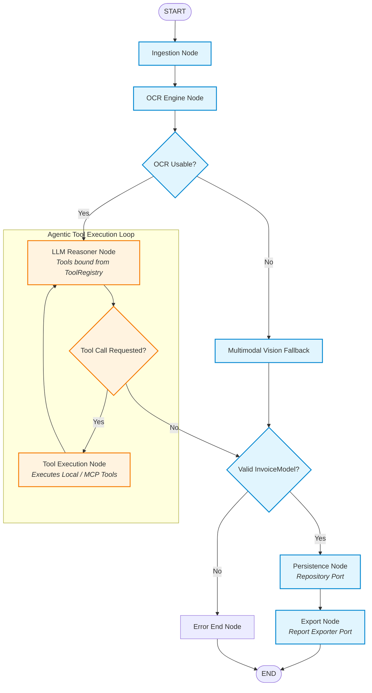
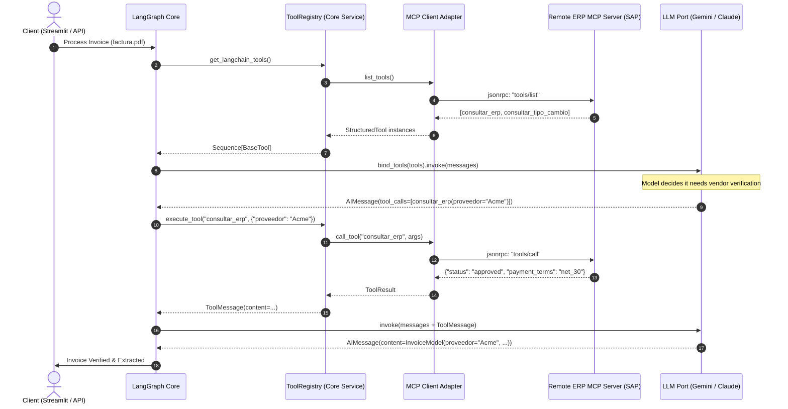

# Enterprise Architecture Proposal: Hexagonal Architecture & Dynamic MCP Integration

**Status:** Proposed  
**Author:** Staff Software Architect  
**Domain:** Autonomous Document Processing / Enterprise Agentic AI  
**Target System:** `agente-facturas` (LangGraph + Gemini + RapidOCR + SQLite)

---

## 1. Executive Summary & Problem Statement

The current implementation of `agente-facturas` is functionally robust and well-tested: it implements a resilient two-tier extraction pipeline (RapidOCR local ONNX $\to$ Gemini Text $\to$ Gemini Vision Fallback $\to$ SQLite $\to$ Excel).

However, in an **Enterprise Production Environment**, the current design presents architectural coupling that limits scalability:
1. **Direct Infrastructure Coupling:** In `agent.py`, domain orchestration logic directly instantiates and calls concrete infrastructure modules (`MotorOCR`, `ChatGoogleGenerativeAI`, `insertar_factura`, `exportar_excel`).
2. **Static Tooling:** The LangGraph state machine is hard-wired. It cannot dynamically discover, register, or execute tools at runtime (e.g., verifying purchase orders against an ERP like SAP/NetSuite, checking exchange rates, or invoking headless browser agents via MCP).
3. **Rigid Vendor Lock-In:** Swapping Gemini for an on-premise LLM (Ollama, vLLM) or SQLite for PostgreSQL/DynamoDB requires touching core orchestration code.
4. **Testing Friction:** End-to-end integration tests must mock concrete classes or make real API calls, rather than injecting lightweight test doubles at defined protocol boundaries.

To scale this system into an enterprise-grade agent platform capable of consuming **Model Context Protocol (MCP)** servers dynamically, we propose refactoring the architecture to **Hexagonal Architecture (Ports & Adapters)** with a **Dynamic Tool Registry**.

---

## 2. Hexagonal Architecture (Ports & Adapters) Specification

### 2.1 Core Architectural Principles
* **Dependency Inversion Principle (DIP):** High-level business logic (LangGraph state machine and invoice parsing domain) must not depend on low-level details (Gemini API, RapidOCR ONNX runtime, SQLite filesystem driver). Both depend on abstractions (*Ports*).
* **Isolation of the Core:** The core domain knows nothing about HTTP, MCP JSON-RPC, SQL queries, or third-party SDKs.
* **Pluggability:** Adapters can be added, replaced, or mocked without altering a single line of domain orchestration logic.

---

### 2.2 Layer Decomposition

```
┌────────────────────────────────────────────────────────────────────────────────────────┐
│                                  DRIVING ADAPTERS                                      │
│           [Streamlit UI]          [CLI / Batch Worker]          [REST API / Webhooks]  │
└───────────────────────────────────────────┬────────────────────────────────────────────┘
                                            │ Calls
                                            ▼
┌────────────────────────────────────────────────────────────────────────────────────────┐
│                              INBOUND PORTS (Use Cases)                                 │
│                      • ProcessInvoiceUseCasePort                                       │
│                      • BatchIngestionUseCasePort                                       │
└───────────────────────────────────────────┬────────────────────────────────────────────┘
                                            │
                                            ▼
┌────────────────────────────────────────────────────────────────────────────────────────┐
│                                 CORE DOMAIN & AGENT                                    │
│                                                                                        │
│   ┌────────────────────────────────────────────────────────────────────────────────┐   │
│   │                         LangGraph State Machine                                │   │
│   │                                                                                │   │
│   │   [ Ingest ] ──▶ [ OCR ] ──▶ [ LLM Reasoner + Dynamic Tools ] ──▶ [ Persist ]  │   │
│   │                              │                 ▲                               │   │
│   │                              ▼                 │                               │   │
│   │                         [ Tool Exec ] ─────────┘                               │   │
│   └────────────────────────────────────────────────────────────────────────────────┘   │
│                                                                                        │
│   ┌──────────────────────────────┐          ┌──────────────────────────────────────┐   │
│   │     Pure Domain Entities     │          │         Tool Registry Service        │   │
│   │  • InvoiceModel              │          │  • Dynamic Tool Registry             │   │
│   │  • InvoiceItem               │          │  • Tool Schema Introspection         │   │
│   │  • Validation Rules          │          │  • Permission & Execution Context    │   │
│   └──────────────────────────────┘          └──────────────────────────────────────┘   │
└───────────────────────────────────────────┬────────────────────────────────────────────┘
                                            │ Depends on
                                            ▼
┌────────────────────────────────────────────────────────────────────────────────────────┐
│                              OUTBOUND PORTS (Interfaces)                               │
│  • OcrEnginePort              • LlmReasoningPort            • InvoiceRepositoryPort    │
│  • VisionFallbackPort         • ReportExporterPort          • McpToolProviderPort      │
└───────────────────────────────────────────┬────────────────────────────────────────────┘
                                            │ Implemented by
                                            ▼
┌────────────────────────────────────────────────────────────────────────────────────────┐
│                                  DRIVEN ADAPTERS                                       │
│                                                                                        │
│   [ RapidOCR / ONNX ]       [ Gemini 1.5 Flash ]          [ SQLite / SQLAlchemy ]      │
│   [ AWS Textract ]          [ Anthropic Claude 3.5 ]      [ PostgreSQL / RDS ]         │
│   [ Tesseract CPU ]         [ Local Ollama / DeepSeek ]   [ OpenPyXL Excel Exporter ]  │
│                                                                                        │
│   ┌────────────────────────────────────────────────────────────────────────────────┐   │
│   │                       MCP (Model Context Protocol) Adapters                    │   │
│   │  • StdioMcpClientAdapter (Playwright, Local Shell, Filesystem)                 │   │
│   │  • SseMcpClientAdapter (Remote ERP: SAP / Oracle NetSuite, Currency API)      │   │
│   └────────────────────────────────────────────────────────────────────────────────┘   │
└────────────────────────────────────────────────────────────────────────────────────────┘
```

---

## 3. Component Details & Interface Contracts (Ports)

### 3.1 Driving Ports (Inbound)
```python
from typing import Protocol
from pathlib import Path
from models import InvoiceModel


class ProcessInvoiceUseCasePort(Protocol):
    """Primary entry point for invoice processing."""

    def execute(self, file_path: Path) -> InvoiceModel: ...
```

### 3.2 Driven Ports (Outbound)

#### A. `OcrEnginePort`
```python
from typing import Protocol, NamedTuple
from pathlib import Path


class OcrResult(NamedTuple):
    text: str
    confidence: float
    detected_lines: int
    is_usable: bool


class OcrEnginePort(Protocol):
    def prepare_inputs(self, file_path: Path) -> list[Path]: ...
    def extract_text(self, image_path: Path) -> OcrResult: ...
```

#### B. `LlmReasoningPort` (Supporting Dynamic Tools)
```python
from typing import Protocol, Any, Sequence
from langchain_core.tools import BaseTool
from models import InvoiceModel


class LlmReasoningPort(Protocol):
    def bind_tools(self, tools: Sequence[BaseTool]) -> "LlmReasoningPort": ...
    def extract_structured(self, ocr_text: str) -> InvoiceModel: ...
    def reason_with_tools(self, messages: list[Any]) -> Any: ...
```

#### C. `InvoiceRepositoryPort`
```python
from typing import Protocol
from models import InvoiceModel


class InvoiceRepositoryPort(Protocol):
    def save(self, invoice: InvoiceModel, source_file: str, method: str) -> int: ...
    def get_by_id(self, invoice_id: int) -> InvoiceModel | None: ...
```

#### D. `McpToolProviderPort` (Dynamic Tool Discovery)
```python
from typing import Protocol, Any
from langchain_core.tools import BaseTool


class McpToolProviderPort(Protocol):
    """Adapter interface for Model Context Protocol client connections."""

    async def connect(self, server_url_or_cmd: str) -> None: ...
    async def list_available_tools(self) -> list[BaseTool]: ...
    async def call_tool(self, tool_name: str, arguments: dict[str, Any]) -> Any: ...
```

---

## 4. LangGraph Core Isolation & Dynamic Tool Loop

In this architecture, LangGraph sits entirely within the **Core Application Layer**. The graph operates strictly on state and invokes injected ports.

When enhanced with **Dynamic Tools & MCP**, the graph transitions from a purely sequential DAG to an **Agentic Loop** with dynamic tool calling capabilities:



---

## 5. Integrating the Model Context Protocol (MCP)

### 5.1 Why MCP in Enterprise Invoice Processing?
In real enterprise workflows, an invoice is rarely accepted blindly upon OCR extraction. It must be cross-referenced:
1. **ERP Validation (SAP / NetSuite):** Does the PO number exist? Is the vendor approved in the master record?
2. **Tax & Compliance Verification:** Does the tax ID (RFC/CIF/VAT) match official government registries via external API?
3. **Forensic Fraud Detection:** Has an invoice with this exact vendor, date, and amount already been paid?
4. **Foreign Exchange (FX):** For international invoices, what was the official central bank exchange rate on the invoice issue date?

MCP standardizes how LLMs connect to these diverse data sources and execution sandboxes over standard I/O or SSE.

### 5.2 Interaction Sequence (LangGraph $\leftrightarrow$ ToolRegistry $\leftrightarrow$ MCP)



---

## 6. Enterprise Migration Roadmap (Evolutionary, Zero-Downtime)

| Phase | Milestone | Scope | Risk |
|---|---|---|---|
| **Phase 1** | **Dynamic Tool Registry** *(Current Step)* | Implement `tools/registry.py` and dynamic discovery. Add simulated and MCP tools. Build `agent_v2_draft.py` as a non-breaking preview. | **Zero** (no changes to existing production files). |
| **Phase 2** | **Port Extraction & Inversion** | Define `ports/` package with `Protocol` classes. Wrap existing `MotorOCR`, `ChatGoogleGenerativeAI`, and `db_handler` into `adapters/`. Refactor `agent.py` to accept ports via factory functions. | **Low** (preserves exact behavior, covered by existing 61 test cases). |
| **Phase 3** | **Production MCP Client Integration** | Connect to real MCP servers over SSE / Stdio using `mcp` SDK. Add authentication, rate-limiting, and distributed tracing (OpenTelemetry). | **Medium** (requires MCP infrastructure & credentials). |
| **Phase 4** | **Multi-Tenant Routing & Orchestration** | Support tenant-specific toolsets (Tenant A has SAP adapter, Tenant B has NetSuite adapter), configurable via tenant context in state. | **Low** (handled via runtime registry resolution). |

---

## 7. Staff Architect Recommendation

1. **Keep the Pure Core Pure:** Do not import MCP or LangChain SDK specifics into domain entities.
2. **Favor Composition over Inheritance:** Use Python `typing.Protocol` for compile-time duck typing (compatible with strict `mypy`).
3. **Decouple Tool Discovery from Graph Execution:** The LangGraph agent should receive tools as a collection of executable specs, never hardcoding the communication protocol.
