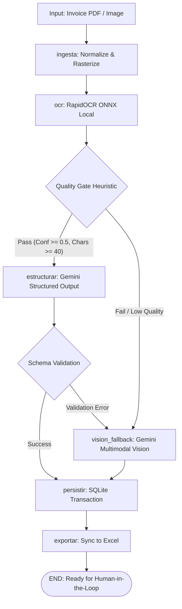

# Autonomous Invoice AI Agent | LangGraph & Pydantic

[](https://www.python.org/downloads/)
[](https://github.com/langchain-ai/langgraph)
[](https://docs.pydantic.dev/)
[](https://streamlit.io/)
[](https://opensource.org/licenses/MIT)

An enterprise-grade **Proof of Concept (PoC)** demonstrating an autonomous document processing agent. The pipeline ingests unstructured and semi-structured invoices (PDF and images), applies a high-efficiency local OCR tier, structures the payload into strictly typed schemas using **Google Gemini**, implements automatic **Multimodal Vision Fallback**, and persists transactional records into SQLite and Excel.

---

## Architecture & Core Design Decisions

Designed from the ground up following Clean Architecture, strict typing, and cost-efficient LLM engineering principles.



### 1. Cost & Token Optimization: Hybrid Two-Tier OCR Strategy
- **Why not send all images directly to Gemini Vision?** Feeding multi-page high-resolution invoice images directly into multimodal models consumes 1,500–3,000+ tokens per image, increases latency, and scales costs linearly with document volume.
- **The Solution:** We leverage **RapidOCR** (ONNX runtime, ~15MB weight footprint, zero GPU requirements) locally. The text output is piped to Gemini as a compact text prompt (~300–500 tokens).
- **Result:** ~85% reduction in token consumption and significantly lower p95 latency on standard legible invoices.

### 2. Autonomous Contingency: Multimodal Vision Fallback
- If the local OCR extraction fails the quality gate (e.g., scan noise, handwritten fields, text length < 40 chars, or average confidence < 0.5), or if structured JSON parsing fails, the agent autonomously routes the raw image to **Gemini Multimodal Vision**.
- Guarantees high extraction recall without manual human intervention.

### 3. StateGraph Orchestration (LangGraph)
- Built on LangGraph's compiled `StateGraph` with an explicit, strongly typed `EstadoAgente` schema.
- Routing logic is decoupled into pure deterministic router functions (`enrutar_post_ocr`, `enrutar_post_estructura`), enabling 100% test coverage without network calls or LLM billing.

### 4. Resilient Structured Outputs with Pydantic v2
- Utilizes `llm.with_structured_output(InvoiceModel)` to enforce schema adherence directly at the model engine level.
- Custom field validators normalize inconsistent locale patterns:
  - Currency strings (e.g., `$`, `€`, `USD`, spaces) and decimal formats (`1.234,56` vs `1,234.56`) normalized to `float`.
  - Heterogeneous date strings parsed into canonical ISO-8601 (`YYYY-MM-DD`).
  - Strict system prompt guardrails against hallucinations: missing values fall back to `null` rather than synthetic data.

### 5. Dependency Injection & Decoupling
- Factory functions (`construir_grafo(motor_ocr, llm)`) accept dependencies at build time.
- Decouples core graph logic from concrete SDK clients, making components effortlessly swappable, extensible, and mockable.

### 6. Relational Persistence & Idempotent Reporting
- Backed by **SQLAlchemy 2.0** models (`facturas` and `items_factura`) on SQLite.
- Excel synchronization (`reporte_facturas.xlsx`) is fully idempotent: SQLite remains the single source of truth, and sheets (`Facturas`, `Items`) are regenerated atomically.

---

## Enterprise Documentation & Governance

For in-depth architectural specifications and governance policies, refer to the following documents:

| Document | Scope |
|---|---|
| [**Architecture Specification**](docs/ARCHITECTURE.md) | Full C4 models, typed state machine semantics, threat analysis, and scaling roadmap. |
| [**ADR 0001: Hybrid OCR Strategy**](docs/adr/0001-hybrid-two-tier-ocr-strategy.md) | Rationale for combining local RapidOCR (ONNX) with automated Multimodal Vision fallback. |
| [**ADR 0002: LangGraph State Machine**](docs/adr/0002-langgraph-state-machine-orchestration.md) | Evaluation of deterministic graph-based state transitions vs autonomous agent loops. |
| [**ADR 0003: Pydantic v2 Structured Outputs**](docs/adr/0003-pydantic-v2-strict-structured-outputs.md) | Schema enforcement, currency/date normalization, and anti-hallucination guardrails. |
| [**Contributing Guide**](CONTRIBUTING.md) | Development standards, pure function testing protocols, and PR lifecycle. |
| [**Security Policy**](SECURITY.md) | Data boundaries, responsible disclosure process, and secret handling. |


---

## Project Structure

```text
.
├── agent.py               # LangGraph StateGraph, nodes, router functions, DI graph factory
├── app.py                 # Streamlit web application & live graph execution
├── db_handler.py          # SQLAlchemy 2.0 ORM models, migrations, & Excel exporter
├── logging_config.py       # Centralized structured logging for CLI & server
├── main.py                # CLI runner and entrypoint for batch processing
├── models.py              # Pydantic v2 domain schemas and data normalization
├── ocr_engine.py           # RapidOCR (ONNX) wrapper & PDF rasterizer
├── tareas.py               # Console entry points: uv run lint | test | dev
├── pyproject.toml         # Dependencies, quality-gate config, uv scripts
├── .env.example           # Environment template (safe for VCS)
├── data/                  # Input invoices (PDF/PNG) — demo files live here
├── scripts/
│   └── crear_factura_demo.py  # Synthetic sample invoice generator (PDF/PNG)
└── tests/
    ├── test_e2e.py         # Full-graph integration test (mocked OCR + Gemini)
    ├── test_agent.py       # Routers, validators, and quality heuristics
    ├── test_agent_nodes.py # Node-level unit tests of the state machine
    ├── test_modelos.py     # Pydantic schemas, parsers, normalization
    ├── test_ocr_engine.py  # OCR wrapper & rasterizer
    ├── test_db_handler.py  # Persistence + idempotent Excel export
    ├── test_main.py        # CLI runner (env loading, arg resolution, exit codes)
    └── test_logging_config.py
```

---

## Quickstart

### Prerequisites

- **Python 3.12+**
- **uv** (recommended package manager): [Install uv](https://docs.astral.sh/uv/getting-started/installation/)
- **poppler-utils** (for PDF rasterization):
  - Ubuntu/Debian: `sudo apt install poppler-utils`
  - macOS: `brew install poppler`

### 1. Installation

Clone the repository and install all dependencies in a virtual environment:

```bash
git clone https://github.com/<your-username>/invoice-ai-agent.git
cd invoice-ai-agent
uv sync
```

### 2. Configure Environment

Create a `.env` file from the provided template:

```bash
cp .env.example .env
```

Edit `.env` and set your Google AI Studio API key:

```env
GEMINI_API_KEY=your_google_ai_studio_api_key_here
# gemini-1.5-flash was retired from ListModels; gemini-2.5-flash is the
# model verified against this pipeline (structured output + multimodal vision):
GEMINI_MODEL=gemini-2.5-flash
```

---

## Running the Application

### Option A: Interactive Web UI (Streamlit)

Launch the web interface to upload invoices, inspect live graph step execution, review structured tables, and download reports:

```bash
uv run dev
```

Extra arguments are forwarded to Streamlit (e.g. `uv run dev -- --server.port 9000`).
Open [http://localhost:8501](http://localhost:8501) in your browser.

### Option B: CLI Batch Processing

Generate a synthetic demo invoice and run the autonomous agent via command line:

```bash
# 1. Generate sample invoice (PDF & PNG in data/)
uv run python scripts/crear_factura_demo.py

# 2. Process all invoices in ./data
uv run python main.py

# Or process a specific invoice file directly:
uv run python main.py path/to/invoice.pdf --debug
```

Generated outputs will be saved to `facturas.db` (SQLite) and `reporte_facturas.xlsx`.

---

## Quality Gates & Automation

Every change is gated before it reaches `main`. Three console shortcuts are wired in `pyproject.toml`
(`[project.scripts]` → `tareas.py`):

```bash
uv run lint   # ruff check --fix + ruff format + mypy (strict)
uv run test   # pytest with branch-coverage report
uv run dev    # Streamlit server (args forwarded: uv run dev -- --server.port 9000)
```

| Gate | Tooling | Current status |
|---|---|---|
| Lint & format | `ruff` (pycodestyle, pyflakes, isort, pyupgrade, bugbear; line-length 110) | ✅ 0 issues |
| Type checking | `mypy` in strict mode (`disallow_untyped_defs`, pydantic plugin) | ✅ 0 issues in 17 files |
| Tests | `pytest` — 61 offline tests (unit, node-level, CLI, end-to-end) | ✅ all passing |
| Coverage | `pytest-cov` with `branch = true` | ✅ 90.8 % overall (db_handler 100 %, agent 91 %) |

**End-to-end without billing.** `tests/test_e2e.py` drives the *entire* `StateGraph`
(ingesta → OCR → estructurar/persistir/exportar, including the vision-fallback detours) with
`unittest.mock.patch` replacing RapidOCR and the Gemini parser, and isolated SQLite/Excel artifacts in
`tmp_path`. The suite never consumes API quota and runs offline in ~2 s.

**Structured logging.** All entry points share one configuration (`logging_config.py`); scattered
`print()` calls were removed, and noisy third-party loggers are demoted:

```text
[2026-10-30 08:23:33] [INFO] [agent.py] - Nodo 'ingesta': analizando data/factura_demo.png
[2026-10-30 08:23:33] [INFO] [db_handler.py] - Insertada factura #1 (ACME S.A., total=8059.21)
```

---

## Production Roadmap

- [ ] **LangGraph Checkpointer**: Add persistent SQLite/PostgreSQL checkpointing for fault-tolerant pause/resume and Human-in-the-Loop review.
- [ ] **Duplicate Detection**: Unique hash fingerprints and invoice number + vendor deduplication before database commit.
- [ ] **Distributed Queue**: Celery/RabbitMQ or AWS SQS integration for asynchronous high-throughput document ingestion.
