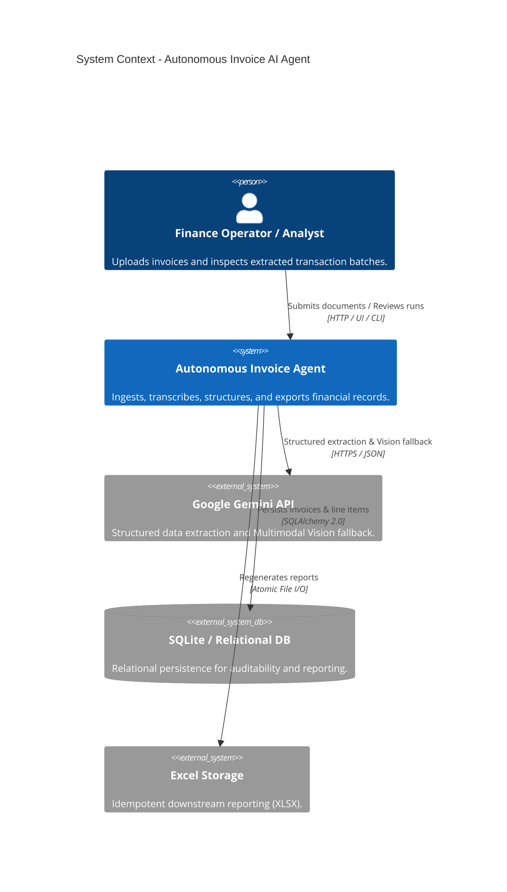
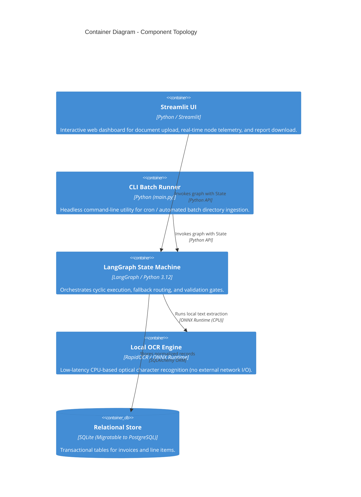
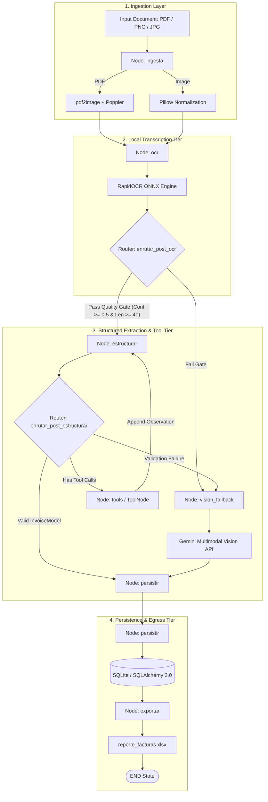
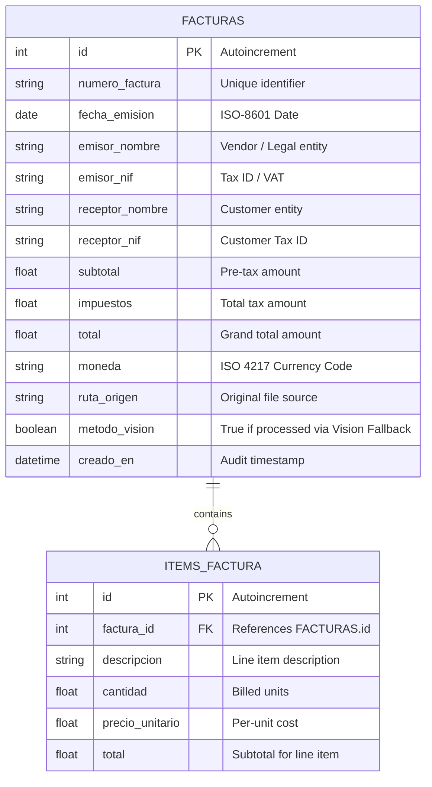

# System Architecture Specification

## 1. Executive Summary & System Goals

The **Autonomous Invoice AI Agent** is an enterprise-grade document processing pipeline designed to ingest, normalize, transcribe, and structure heterogeneous financial documents (PDFs and scanned images). 

The primary business objective is maximizing data extraction accuracy while minimizing operational expenditure (OpEx) associated with LLM token usage and latency.

### Key Architectural Tenets
1. **Cost-Aware AI (Frugal Engineering):** Never invoke multimodal vision APIs when lightweight, high-speed local inference can perform the extraction.
2. **Deterministic State Machine:** Agentic workflows must follow strict, verifiable state transitions rather than stochastic black-box autonomous loops.
3. **Type Safety & Schema Integrity:** Data contracts are enforced via Pydantic v2 at the compiler/runtime boundary; hallucinations or schema drift are treated as fatal execution faults.
4. **Clean Decoupling:** Business domain logic, OCR engines, LLM clients, and persistence layers interact via Dependency Injection and strict protocols.

---

## 2. C4 Model Architecture

### 2.1 Level 1: System Context Diagram

### 2.2 Level 2: Container Diagram

### 2.3 Level 3: Component Diagram (LangGraph Workflow)

---

## 3. State Machine & Graph Lifecycle

The core execution graph is defined as a LangGraph `CompiledStateGraph` passing a typed dictionary (`EstadoAgente`) through sequential and conditional nodes.

### 3.1 State Schema Contract (`EstadoAgente`)

| Field | Type | Description |
|---|---|---|
| `archivo_entrada` | `str` | Original file path (PDF or image). |
| `rutas_imagenes` | `list[Path]` | Normalized PNG page paths for processing. |
| `imagen_fallback` | `str \| None` | Path to representative image for multimodal fallback. |
| `texto_ocr` | `str` | Raw text transcribed across all pages. |
| `confianza_ocr` | `float` | Weighted mean confidence score of OCR lines $[0.0, 1.0]$. |
| `ocr_util` | `bool` | Heuristic evaluation flag indicating if text is usable. |
| `factura` | `InvoiceModel \| None` | Pydantic v2 domain model adhering to financial rules. |
| `metodo_extraccion` | `str` | Extraction method (`METODO_OCR_LLM` or `METODO_VISION_FALLBACK`). |
| `registro_id` | `int` | Primary key assigned in SQLite database (`facturas.id`). |
| `error` | `str \| None` | Explanatory message if graph aborted or failed. |
| `messages` | `list[BaseMessage]` | Conversational history with `add_messages` reducer for MCP tool execution. |
| `auditoria_erp` | `dict[str, Any] \| None` | Supplementary accounting verification data from tools. |
| `herramientas_usadas` | `list[str]` | Audit list of tool names executed during extraction. |

### 3.2 Routing & Transition Matrix

| Current State / Node | Decision Condition | Next Node | Rationality |
|---|---|---|---|
| `ingesta` | File normalized and rasterized | `ocr` | Document converted to standard image format. |
| `ingesta` | Missing file or rasterization exception | `END` | Unrecoverable I/O error; state reports descriptive error. |
| `ocr` | `len(texto) >= 40` AND `confianza >= 0.5` AND has digits | `estructurar` | Text quality is sufficient for token-efficient LLM prompt. |
| `ocr` | `texto == ""` OR `confianza < 0.5` OR text too short | `vision_fallback` | Local OCR failed to resolve structure; trigger multimodal vision. |
| `estructurar` | Last message contains `tool_calls` | `tools` | LLM requires auxiliary accounting validation (ERP / FX). |
| `tools` | Execution finished | `estructurar` | Observations appended to `messages`; LLM continues reasoning. |
| `estructurar` | `factura != null` AND `factura_util(factura) == True` | `persistir` | Extraction conforms to Pydantic domain invariants. |
| `estructurar` | Validation error OR missing mandatory fields | `vision_fallback` | Text transcription lacked semantic coherence for schema alignment. |
| `vision_fallback` | `factura != null` | `persistir` | Multimodal model recovered document structure. |
| `vision_fallback` | Extraction failed or unrecoverable error | `END` | Document cannot be transcribed; pipeline aborts with error. |
| `persistir` | Insertion committed | `exportar` | Database state updated; regenerate reports. |
| `exportar` | Report regenerated | `END` | Batch step complete. |

---

## 4. Data Model & Entity Relationship

Persistence is handled by SQLAlchemy 2.0 using relational integrity constraints and cascading deletions.

---

## 5. Security & Threat Modeling

| Threat Vector | Risk Level | Mitigation Architecture |
|---|---|---|
| **API Key Exposure** | **Critical** | Zero hardcoded secrets. Strict `.gitignore` blocking `.env*`, environment validation at container startup, no secrets committed to VCS. |
| **Data Ingestion Vulnerability (Malicious PDF/Image)** | **High** | Sanitization and buffer boundaries handled by Poppler and Pillow; processing runs in isolated worker context. |
| **Model Hallucination / Financial Drift** | **High** | Pydantic v2 strict validator types. Currency and dates normalized with regex. Prompt rules strictly forbid synthetic fields: missing attributes must map to `null`. |
| **Data Leakage in Public Cloud** | **Medium** | 85%+ of invoices are transcribed locally on-premise/in-container. Only text representations (or images upon fallback) transit encrypted over HTTPS to Google AI Studio. |

---

## 6. Enterprise Scalability Roadmap

For multi-tenant high-throughput enterprise deployments ($>100,000$ invoices/day), the architecture is prepared for the following transitions:
1. **LangGraph Checkpointer on PostgreSQL:** Replace in-memory compiled graphs with `PostgresSaver` to persist graph execution checkpoints across distributed nodes.
2. **Asynchronous Ingestion (Celery / Redis / SQS):** Move from synchronous Streamlit/CLI calls to an event-driven worker pool.
3. **Blob Storage Integration (AWS S3 / GCP Cloud Storage):** Abstract local filesystem paths (`data/`) into signed URIs with lifecycle expiration.
